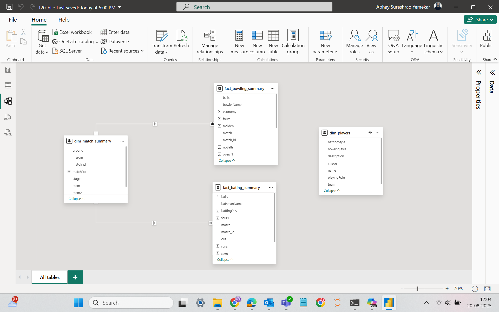

# CricketStat Pro

**Picking a T20 World Cup Playing XI from data instead of gut feel.**

An end-to-end analytics project built during my internship at PHN Technology (Jul – Oct 2023): scrape all 45 matches of the ICC Men's T20 World Cup 2022 from ESPNcricinfo, clean and model it, and turn it into an interactive Power BI report that shortlists players by role and assembles a "Clutch Core XI".


## Pipeline

```
ESPNcricinfo ──► Bright Data scrapers ──► JSON ──► pandas notebook ──► CSV (star schema) ──► Power Query ──► Power BI + DAX
                 web_scrapping_codes/     t20_json_files/  t20_data_preprocessing.ipynb   t20_csv_files/
```

1. **Scrape.** Four Bright Data scrapers ([`web_scrapping_codes/`](web_scrapping_codes)) collect match results, batting and bowling scorecards, and player profiles into [`t20_json_files/`](t20_json_files).
2. **Clean and link.** [`t20_data_preprocessing.ipynb`](t20_data_preprocessing.ipynb) flattens the JSON with pandas, derives a match id from each scorecard and maps both team orders ("A Vs B" / "B Vs A") to it so every innings joins to its match, flags out / not out from the dismissal text, and strips encoding artefacts from player names.
3. **Model.** A star schema in [`t20_csv_files/`](t20_csv_files): `dim_match_summary`, `dim_players`, `fact_bating_summary`, `fact_bowling_summary`.
4. **Shape and measure.** Power Query transforms plus DAX measures and calculated columns (batting average, strike rate, boundary %, average balls faced, bowling average, economy, bowling strike rate, dot-ball %), documented in [`DAX Measures and Calculated columns.xlsx`](DAX%20Measures%20and%20Calculated%20columns.xlsx).
5. **Report.** A 10-page Power BI report with a page per role (power hitters / openers, anchors / middle order, finishers / lower-order anchors, all-rounders, specialist fast bowlers) that shortlists players by parameters, then assembles the final XI with live team-level KPIs.

## The report

| Cleaning the scraped JSON with pandas | Power hitters / openers page |
|---|---|
|  |  |
| **Shortlisting by parameters** | **Star-schema data model** |
|  |  |

More captures are in [`Screenshots/`](Screenshots).

## Run it yourself

- **Report:** open [`Cricket Stat Pro.pbix`](Cricket%20Stat%20Pro.pbix) in Power BI Desktop. `Stage-2.pbix`, `Stage-3.pbix` and `t20_cric_1_power_query.pbix` are the intermediate stages.
- **Data prep:** `pip install pandas jupyter`, then run `t20_data_preprocessing.ipynb` from the repository root to regenerate `t20_csv_files/` from `t20_json_files/`.

## Stack

Python · pandas · Jupyter · Bright Data · Power Query · DAX · Power BI

---

Built by [Abhay Yemekar](https://github.com/abhay-yemekar) · [abhayemekar.me](https://abhayemekar.me) · [LinkedIn](https://www.linkedin.com/in/abhayyemekar/)
